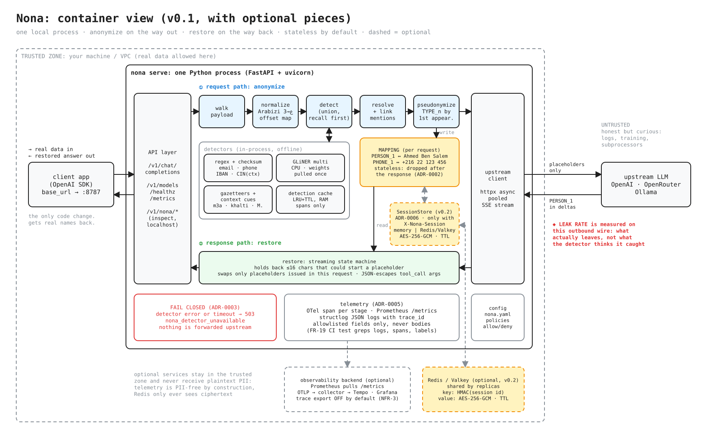
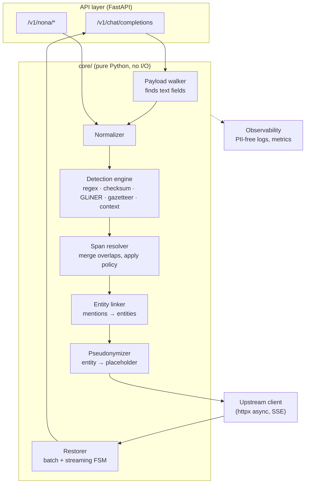
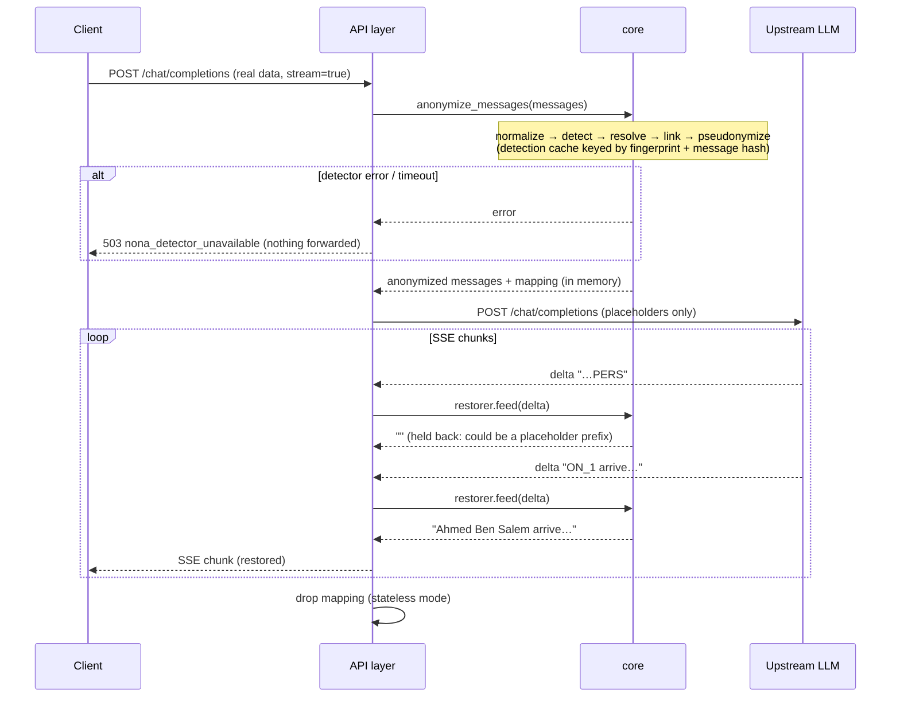
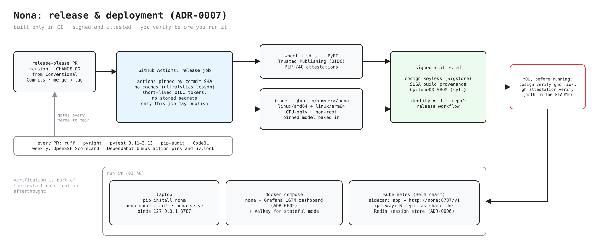
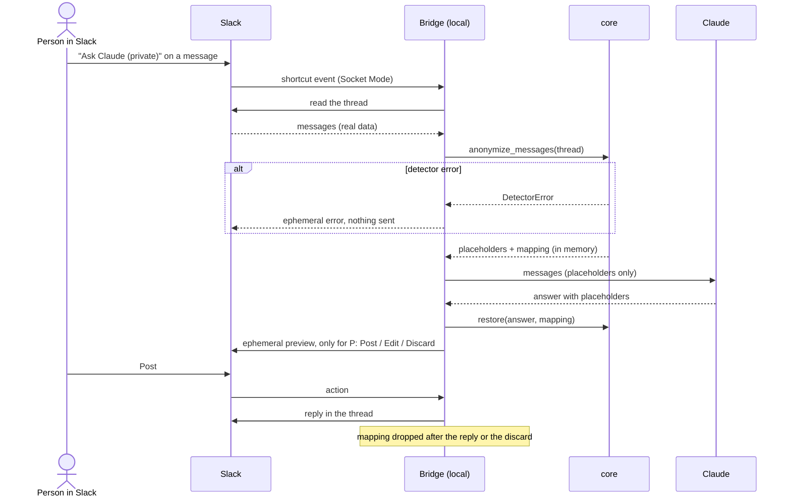

# 03 — High-level design

> Status: **Draft v0.1** · Depends on: [01](01-requirements.md), [02](02-api.md)

## 1. Context



<sub>Editable source: `docs/diagrams/nona-architecture.excalidraw` (Excalidraw VS Code extension or excalidraw.com). Both files are generated by `docs/diagrams/generate.py`. If you edit the `.excalidraw` by hand, re-export the SVG.</sub>

How to read it: the **request path** (blue) turns real values into placeholders and writes the **mapping** (yellow, the only sensitive state, which lives in RAM for one request). The **response path** (green) reads the mapping to put real values back. Everything left of the upstream client is trusted.

The trust boundary is the arrow that leaves the local box. Everything the benchmark measures is measured **on that arrow**.

## 2. Components



| Component | Responsibility | Key decision |
|---|---|---|
| **Payload walker** | Visits every user-controlled string in an OpenAI request (02 §1 table) and writes the replacements back | Pure function over pydantic models, so it is easy to test against OpenAI fixtures |
| **Normalizer** | NFKC, folds case, Eastern Arabic digits to ASCII, strips Arabic tatweel and diacritics, and keeps an exact offset map back to the original text (`core/normalize.py`). The **Arabizi digit map** (`3→ع, 7→ح, 9→ق, 5→خ, 2→ء`) is a second view for name recognizers (S4): applied to the same view it would turn phone numbers into letters | Detection runs on the normalized view, replacement on the original text |
| **Detection engine** | Runs recognizers and returns candidate `Span`s with scores | Plugin interface (`Recognizer` protocol). Union of recognizers, because recall comes first |
| **Span resolver** | Resolves overlaps (longest span wins, then type priority, then score), applies the score threshold and the allow/deny lists (`core/resolver.py`). Denylist terms become `CUSTOM` spans | Deterministic: the result doesn't depend on recognizer order (property-tested), a requirement for ADR-0002 |
| **Entity linker** | Groups mentions into entities (`Ahmed` ≈ `Ahmed Ben Salem`). An email that spells a name (`ahmed.bs@…`) stays its own `EMAIL_n` entity and records that person as its `owner` | Conservative: only merges when unambiguous (deep dive B) |
| **Pseudonymizer** | Assigns `TYPE_n` in order of first appearance and applies the per-type policy: `pseudonymize`, `redact` (`[CARD]`, irreversible) or `keep` (`core/pseudonymize.py`). Placeholder-like text already in the input (`PERSON_1`, `person 2`) keeps its number reserved, so it is never issued and restoring can't rewrite it. If the user types a placeholder whose number was already issued (`PHONE_1` in message 3), it becomes an entity whose value is the literal text: it goes upstream as a fresh placeholder (`PHONE_2`) and comes back exactly as typed | Format chosen in ADR-0001 |
| **Upstream client** | Forwards the request and streams the response | Shared `httpx.AsyncClient` with connection pooling |
| **Restorer** | Replaces issued placeholders in the output, both in full responses and token streams | Streaming finite-state machine (deep dive D) |

`core/` does no network or file I/O, so it is fast to test and reusable as a library.

## 3. Request lifecycle



## 4. State: stateless by default

Chat Completions is stateless: the client sends the **whole history** on every call. So Nona re-anonymizes the
whole history on every request and keeps nothing between requests (ADR-0002).

- **Consistency** comes from determinism plus **causal linking** ([ADR-0004](../adr/0004-causal-entity-linking.md)): each message
  is linked using only itself and the messages before it, and earlier decisions are frozen. So adding a new message never
  renumbers earlier ones (`anonymize_messages(msgs[:k]).texts == anonymize_messages(msgs).texts[:k]`, a property test), which also keeps the provider's
  prompt cache warm.
- **Forward propagation**: once a name is known, every later occurrence of the same text is masked even if the NER misses it.
  This is what stops restored assistant answers, which the client sends back, from leaking on the next turn.
- **Cost**: re-running NER on the whole history. Mitigation: an in-process LRU cache of *detection results* keyed by
  `sha256(fingerprint + message text)`, the fingerprint covering the nona version, the detection config and (from S4) the model revision, so an upgrade or a config change never serves stale spans (ADR-0004). It holds spans and offsets only. The hash of PII is still sensitive, so the cache lives in
  memory only and has a TTL. Implemented in #40 ([`core/cache.py`](../../src/nona/core/cache.py)): it caches what the
  recognizers find in each message. Forward propagation, the resolver and look-ahead depend on the conversation, so they
  run on every request. The denylist runs after the cache too, not because it depends on the conversation but because
  it's a setting: changing it must not require new cache keys. The fingerprint covers each recognizer's type and configuration (a
  recognizer without one, or a subclass that doesn't define its own, shares with nothing else). LRU of 4,096
  messages, one-hour TTL; expired entries are swept on access, at most every quarter of the TTL. Replaying `dev` the way
  the proxy sees it (every prefix of every conversation), detection runs drop from 698 to 245.
- **Stateful mode** (v0.2, `X-Nona-Session`) is for clients that truncate history or use server-side conversation state.
  A `SessionStore` holds the mapping: in memory for one process, or Redis/Valkey for several replicas, encrypted per
  session with AES-GCM and a TTL ([ADR-0006](../adr/0006-encrypted-session-store.md)).

## 5. Concurrency & performance

- One uvicorn worker, async I/O. NER inference runs in a thread pool (`anyio.to_thread`), batched per request across messages.
- Model loaded once at startup, and readiness gated by `/healthz`.
- Latency budget (NFR-6, 300 tokens): normalize 2 ms · regex 3 ms · GLiNER ~80–120 ms · resolve and link 5 ms · rewrite 2 ms.
  GLiNER dominates, so the v0.2 lever is ONNX Runtime with int8 quantization.
- Streaming: restoration holds back only the length of the longest possible placeholder prefix (≤ 16 chars), so the added time-to-first-token stays small.
- Every stage emits an OpenTelemetry span and feeds `nona_stage_duration_seconds`, so this budget is checked against real traces ([ADR-0005](../adr/0005-observability.md)).
- A k6 script (`load/`) drives the proxy against a mock upstream at 1, 8 and 32 concurrent clients and reports p50/p95 overhead and throughput (NFR-15).

## 6. Repository layout

```
nona/
├─ src/nona/
│  ├─ core/            # walker, normalizer, recognizers/, resolver, linker, pseudonymizer, restorer
│  ├─ bridges/         # work-platform bridges (§9, S9): adapter protocol, slack.py
│  ├─ proxy/           # FastAPI app, upstream client, SSE handling
│  │  ├─ telemetry.py  # OTel spans, Prometheus metrics, allowlisted attributes (ADR-0005)
│  │  └─ sessions/     # SessionStore: memory, redis (ADR-0006)
│  ├─ cli.py
│  └─ config.py
├─ bench/
│  ├─ data/            # synthetic dataset (jsonl), generator scripts, DATASHEET.md
│  ├─ systems/         # adapters: nona, presidio, llmguard
│  ├─ metrics.py       # leak rate, over-masking, utility, latency
│  └─ report.py        # → results/README table
├─ demo/               # split-screen page
├─ load/               # k6 load-test scripts and mock upstream
├─ deploy/
│  ├─ compose/         # nona + Grafana LGTM observability demo, nona + Valkey
│  └─ helm/nona/       # Helm chart (sidecar or gateway)
├─ tests/              # unit, property (hypothesis), contract (mock upstream), integration (testcontainers), e2e (ollama)
├─ docs/design/, docs/adr/
├─ Dockerfile, pyproject.toml (uv), THIRD_PARTY.md
```

## 7. Tech stack

| Concern | Choice | Why |
|---|---|---|
| Language | Python 3.11+ (CI runs 3.11, 3.12 and 3.13) | NER ecosystem (GLiNER, Presidio baselines) |
| Packaging | `uv` | Fast, lockfile, reproducible bench (NFR-9) |
| HTTP | FastAPI + uvicorn + httpx | Async streaming, pydantic models for the OpenAI schema |
| NER | GLiNER (multilingual), then ONNX | Zero-shot labels, small, CPU-friendly |
| Phones | `phonenumbers` | Don't hand-roll E.164 |
| Tests | pytest, hypothesis, respx, testcontainers | Property-based round-trip, mocked upstream, real Valkey in integration tests |
| Observability | OpenTelemetry (traces), Prometheus (metrics), structlog (JSON logs), Grafana LGTM for the demo | Vendor-neutral standards. Hand-written spans keep telemetry PII-free (ADR-0005) |
| Session store | in-memory or Redis/Valkey, AES-256-GCM via `cryptography` | Shared state across replicas, unreadable without the session id (ADR-0006) |
| Load testing | k6 | Scriptable, reports percentiles, runs in CI (NFR-15) |
| Work-platform bridge (S9) | Slack Bolt for Python in Socket Mode, the official `anthropic` SDK, in the `slack` extra | Socket Mode needs no public URL, so the bridge runs on a laptop like the proxy (§9) |
| Quality | ruff, pyright, pre-commit, GitHub Actions, CodeQL, pip-audit | — |
| Release | release-please, PyPI Trusted Publishing, GHCR multi-arch, cosign, SLSA provenance, CycloneDX SBOM, OpenSSF Scorecard | Verifiable releases for a tool that sees every prompt (ADR-0007) |
| Deployment | Docker, docker-compose, Helm | Local, demo, and Kubernetes sidecar |
| Bench | Ollama (small local model) for e2e and utility runs on the laptop, a hosted model for the published table | CI runners lack the RAM for a model server; CI uses a mock upstream |

## 8. Deployment



<sub>Editable source: `docs/diagrams/nona-deployment.excalidraw`, generated by `docs/diagrams/generate.py`.</sub>

- `pip install nona-proxy && nona models pull && nona serve`
- `docker run -p 127.0.0.1:8787:8787 ghcr.io/<you>/nona` with a CPU-only image and the model baked in at build time
- Sidecar pattern in Kubernetes or docker-compose: the app talks to `http://nona:8787/v1`.
- Helm chart (`deploy/helm/nona`) for the sidecar or a shared gateway. Several replicas need the Redis session store for stateful mode (ADR-0006).
- `docker compose -f deploy/compose/observability.yml up` starts Nona with Grafana, Prometheus and Tempo and a ready-made dashboard (ADR-0005).
- Every release image is signed and attested. Verify it with `cosign verify` or `gh attestation verify` before running it (ADR-0007).

## 9. Work-platform bridge (planned, S9)

People already copy a Slack thread into Claude, then paste the answer back. The bridge does that round trip
with Nona in the middle, so the thread's personal data never reaches the model.

### Flow



### Components

| Component | Responsibility | Key decision |
|---|---|---|
| **Platform adapter** | Reads a thread, shows a private preview, posts a reply. A small protocol (`read_thread`, `preview`, `post_reply`) | One adapter per platform. Slack first; Teams or Discord later without touching the rest |
| **Slack adapter** | Message shortcut and mention, thread reading, ephemeral messages, buttons | Bolt for Python in Socket Mode: no public endpoint to expose |
| **Bridge service** | Thread → conversation → `Nona.anonymize_messages` → Claude → `restore` → preview | The thread is one conversation, so causal linking applies as is (ADR-0004). Stateless: the thread is read again on every request, like the proxy (ADR-0002) |
| **Model client** | Sends the anonymized conversation to Claude | The official `anthropic` SDK on the Messages API |

### Rules

- **A person approves every post.** The answer first appears as an ephemeral message seen only by whoever asked;
  nothing goes into a channel without a click. The model can be wrong, and a restored answer holds real names.
- **Trust boundary:** the Slack workspace already holds the data, so it is trusted like the client in §1. The
  model provider is the honest-but-curious party, and the leak test measures the payload sent to it.
- **Fail closed** (ADR-0003): a detector error shows an error to the asker, and nothing is sent.
- **PII-free telemetry** (ADR-0005): logs and spans carry ids, counts and timings, never message text.
- **Least privilege:** only the Slack scopes the flow needs (read the thread where it is invoked, write a reply,
  shortcuts). Tokens and the API key come from the environment, never from `nona.yaml` in the repository.
- **Synthetic data only during development:** a personal test workspace with generated threads. Installing the
  bridge in a real workspace is that workspace's decision (admin approval, and the employer's for a work Slack).

### Open choice (ADR-0009, at the start of S9)

Should the bridge call `core` in-process and Claude directly, or go through the proxy, which would then need a Claude upstream? Proposal: **in-process**. `core` is already a library without I/O, the Anthropic SDK is the recommended
way to call Claude, and the proxy stays OpenAI-compatible. The cost is that the bridge has to repeat the proxy's
fail-closed and telemetry wiring, so that wiring should be shared code rather than copied.
