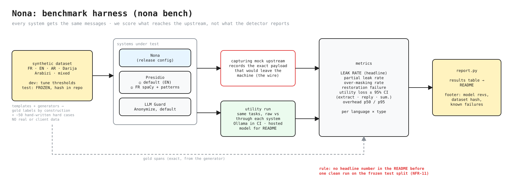

# 04 — Deep dives

> Status: **Draft v0.1** · The hard parts, the options considered for each, and the choice made.

- [A. Detection in mixed French / Arabic / Darija / Arabizi](#a-detection-in-mixed-french--arabic--darija--arabizi)
- [B. Entity linking (consistency)](#b-entity-linking-consistency)
- [C. Placeholder format](#c-placeholder-format)
- [D. Streaming restoration](#d-streaming-restoration)
- [E. Tool calls](#e-tool-calls)
- [F. Benchmark methodology](#f-benchmark-methodology)
- [G. Keeping Nona itself from leaking](#g-keeping-nona-itself-from-leaking)

---

## A. Detection in mixed French / Arabic / Darija / Arabizi

**Why it's hard.** A single WhatsApp message can switch script and language mid-sentence:
`Salam, 3andi rdv m3a Dr. Ben Youssef lundi, ab3athli 3la 98 765 432 wala ميمونة`.
English-trained NER models see `m3a` and `3andi` as noise and mis-tag names next to them.

**Pipeline (ensemble, recall first):**

| Layer | Catches | Notes |
|---|---|---|
| 1. Structured recognizers | email, phone, IBAN, RIB, card, IP, CIN | Regex **plus validation** (mod-97, Luhn, `phonenumbers`). The CIN is "8 digits", which collides with prices and order numbers, so it needs a context word within ±5 tokens (`cin`, `carte d'identité`, `بطاقة`, `ب.ت.و`, `carte`) or it scores low |
| 2. GLiNER (multilingual) | PERSON, LOCATION, ORG | Run on the original text and on the de-Arabizi'd view, then union the results. Candidates: `gliner_multi-v2.1`, `gliner_multi_pii-v1`. Pick on the dev set |
| 3. Gazetteers | Tunisian / Maghrebi first names, surnames, cities | Matched in Latin (several spellings: `Mohamed/Mohammed/Med`), Arabic script, and Arabizi. This layer covers what GLiNER misses in Arabizi |
| 4. Context rules | honorifics and cues: `M.`, `Mme`, `Dr`, `si`, `sidi`, `khalti`, `3amm`, `m3a`, `ism-ou` | Raise the score of the following capitalized token or gazetteer hit |

**Tricky cases to put in tests from day one:**
- Common words that are also names: `Amal` (hope), `Salam`, `Nour`, `Sabri`, `Monastir`. The gazetteer only fires if a context rule or capitalization supports it.
- Phone formats: `+216 22 123 456`, `0021622123456`, `22.123.456`, `٢٢١٢٣٤٥٦` (Eastern Arabic digits, so normalize the digits first).
- Names split by Arabic clitics: `لسامي` = `ل` + `سامي` ("to Sami"). Strip prefix clitics (`ل، ب، و، ف`) on gazetteer misses.

**v0.2+ lever:** fine-tune GLiNER on synthetic Darija/Arabizi data. Full fine-tuning is feasible (a DeBERTa-sized encoder); QLoRA experience transfers. Only do it once the benchmark shows where layer 2 fails.

## B. Entity linking (consistency)

**Goal:** `Ahmed Ben Salem`, `Ahmed`, `M. Ben Salem`, `ahmed.bs@gmail.com` → one entity, `PERSON_1` (and `EMAIL_1` linked to it, for display).

**Algorithm (deterministic, conservative):**
1. Canonicalize each PERSON mention: strip honorifics, normalize case, diacritics and Arabizi, and map known spelling variants (`Mohamed≈Mohammed≈Med`). Produce a token set.
2. Process messages **causally** ([ADR-0004](../adr/0004-causal-entity-linking.md)): message *i* is linked using only itself and earlier messages, and earlier entities are frozen (never merged, split or renumbered).
3. Before linking, **propagate forward**: mask every occurrence in message *i* of a surface form already linked to an earlier entity. This re-catches names in restored assistant turns that the client sends back.
4. A mention is *compatible* with an entity if their token sets are a **subset or superset** of each other. Exactly one compatible entity → join it, absorbing any new tokens (`Ahmed` then `Ahmed Ben Salem` → both `PERSON_1`). None → new entity.
5. Two or more compatible (`Ahmed` when both `Ahmed Ben Salem` and `Ahmed Karoui` exist) → **ambiguous**: give it its own placeholder rather than guess, and reuse it for the same ambiguous form later.
6. Emails and handles link to a person when the local part decomposes into that person's tokens or initials (`ahmed.bs`, `abensalem`, `a.bensalem`).
7. Cross-script: `سامي` ↔ `Sami` through a small transliteration table plus the gazetteer's paired spellings.

**Why conservative:** a wrong *merge* tells the LLM that two people are one person, which corrupts the answer. A wrong *split* only costs some utility. Neither leaks PII, so we optimize for utility without risking the privacy goal.

## C. Placeholder format

See [ADR-0001](../adr/0001-placeholder-format.md). Summary: start with `PERSON_1`-style typed tokens and benchmark realistic fake names as an alternative. French grammatical gender (`il/elle`, `arrivé/arrivée`) is the known weakness of typed tokens. Measure it, don't guess.

## D. Streaming restoration

**Problem:** tokens split placeholders arbitrarily: `"PER" | "SON_" | "1 est"`. Models also mangle them: `Person_1`, `PERSON 1`, `PERSON_1's`, `**PERSON_1**`.

**Finite-state machine:**
- Keep a buffer. After each chunk, find the longest suffix of the buffer that is a prefix of some *issued* placeholder pattern (the case-insensitive regex `(PERSON|PHONE|…)[ _]?\d+`).
- Emit everything before that suffix, after restoring complete matches. Hold back the suffix (≤ 16 chars).
- On stream end (or a `finish_reason` chunk), flush and restore.
- Only restore numbers that were issued: if the model invents `PERSON_9`, leave it as is and count `nona_restore_unknown_total`.
- Chunk boundaries in the output stream can change, but the concatenated text is identical. Property test: for any random split of an output string, `concat(feed(chunks)) + flush() == restore(full)`.

**Metric:** *restoration failure rate*, the share of placeholders still visible to the end user. It is reported in the benchmark.

## E. Tool calls

- **Down (LLM → client):** `tool_calls[].function.arguments` streams as JSON fragments. Restore over the concatenated argument string with the same state machine. Restored values are JSON-escaped (a name containing `"` must not break the JSON).
- **Up (client → LLM):** `role: tool` messages are anonymized like any other text. If the content is JSON, walk only its string values.
- **Agent loops:** the agent executes `send_sms(to="PHONE_1")`? No: the client always receives restored arguments, so tools run on real data and the LLM only ever sees placeholders.

## F. Benchmark methodology

This is the most important deliverable after the proxy itself, so the method has to hold up.

**Dataset (`bench/data`, all synthetic):**
- **Templated generation with gold labels by construction**: templates (written by hand, in each language and mix) with typed slots, filled from fake-value generators (Faker `fr_FR`/`ar`, plus Tunisian name, city, phone and CIN generators). The labels are exact because the generator inserted the entities.
- **Free-form generation**: an LLM writes realistic WhatsApp-style messages around supplied fake entities. A human checks every message and fixes the labels where the model paraphrased.
- **A hand-written hard set** (~50 messages): names that are common words, Eastern Arabic digits, clitics, Arabizi variants.
- Split: `dev` (tune thresholds here) and `test` (**frozen**, hash in the repo, never used for tuning). Publish `DATASHEET.md` (how it was made, its limits, and that it is synthetic).
- v0.1 target: 300+ messages, balanced across FR / EN / AR / Darija-Arabizi / mixed.

**Metrics:**

| Metric | Definition |
|---|---|
| **Leak rate** (headline) | Share of gold PII entities whose value, or any normalized variant of it, appears in the **payload actually sent upstream** |
| Partial leak rate | Share where some token of the value leaks (e.g. the surname) |
| Over-masking rate | Share of non-PII tokens that were replaced (this degrades utility) |
| Utility loss | Answer quality, raw vs through Nona, on 3 tasks: (1) extract the appointment {who, when, phone}, scored exactly against gold, (2) draft a reply, scored by an LLM judge comparing pairs with positions swapped, (3) summarize. Reported with 95% bootstrap confidence intervals |
| Restoration failure rate | Deep dive D |
| Overhead | p50/p95 latency added |

**Baselines, fairly configured:**
- Presidio, default (English) **and** with a French spaCy model plus extra pattern recognizers for phone/IBAN, so it gets its best reasonable setup.
- LLM Guard `Anonymize` scanner, default settings.
- Every configuration lives in `bench/systems/*.py`. Anyone can rerun it with `nona bench`.

**Reporting rules (NFR-11):** results broken down by language and entity type, failures shown next to wins, model revisions and dataset hash printed in the table footer. **No headline number goes in the README before the test split has been run once, cleanly.**

## G. Keeping Nona itself from leaking

- Structured logging with an **allowlist** of fields (request id, counts, timings). Bodies are never logged.
- CI test: run the e2e suite with `DEBUG` logging, then grep every log line for every gold PII value. Any hit fails the build.
- Exceptions: a custom handler strips request payloads from tracebacks.
- Be honest about the limits: Python cannot reliably zero memory, and the mapping lives in RAM until garbage collection. Documented in the threat model.
